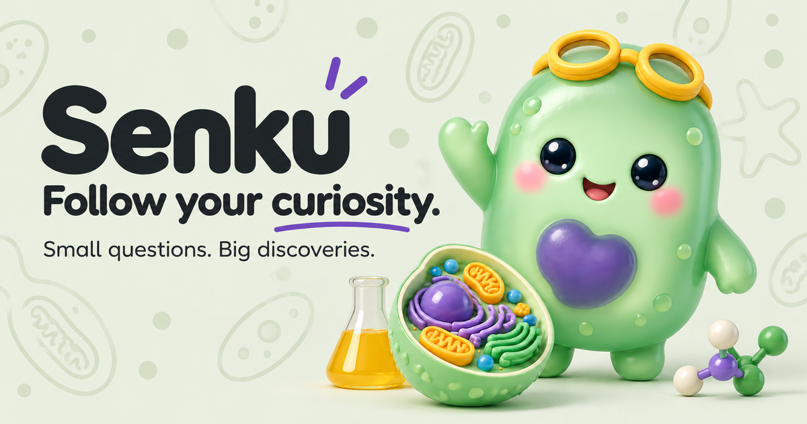
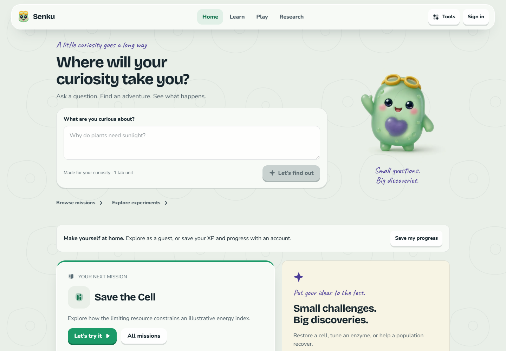
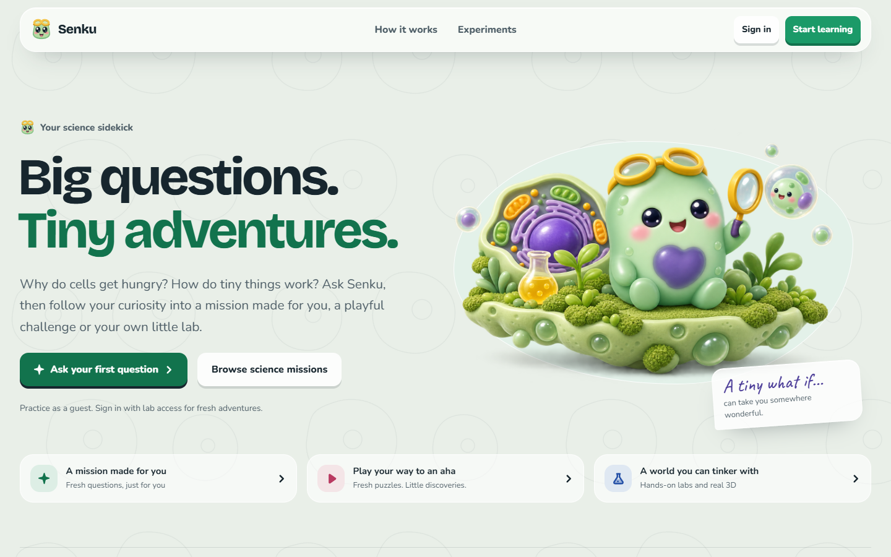
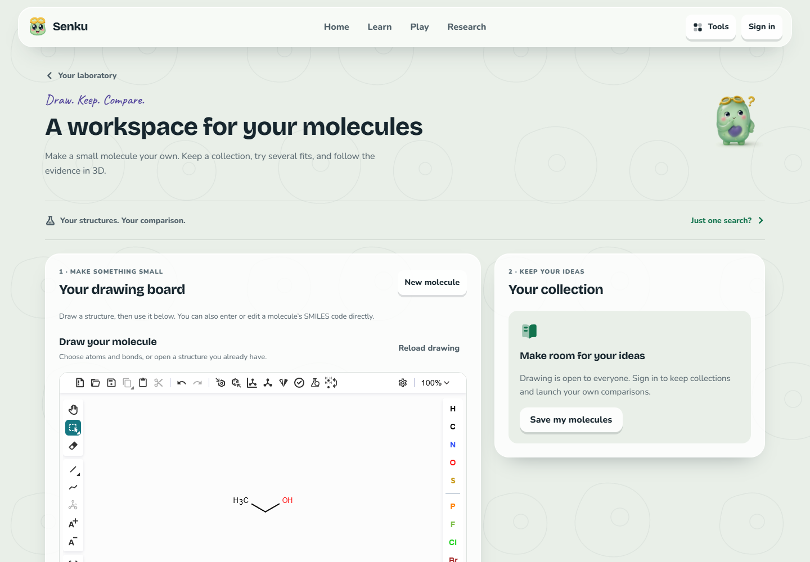
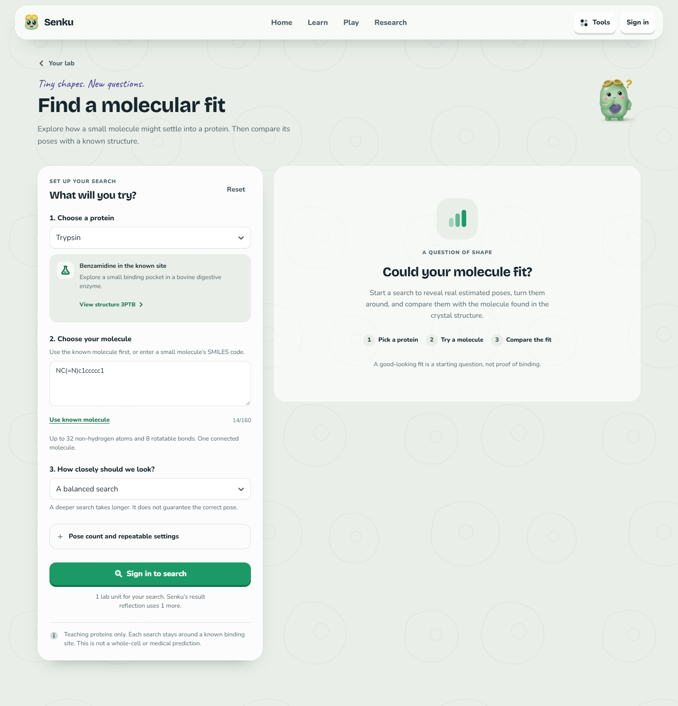
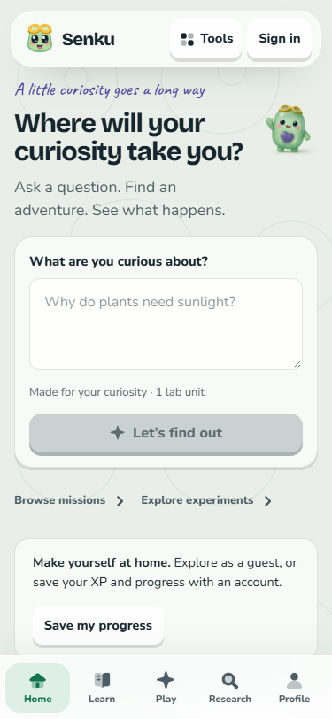

<p align="center">
  
</p>

<h1 align="center">Senku</h1>
<p align="center"><strong>Small questions. Big discoveries.</strong></p>
<p align="center">A playful biology laboratory where learners ask, experiment, compare and explain.</p>
<p align="center">
  <a href="https://github.com/Afnanksalal/senku/actions/workflows/backend.yml"></a>
  <a href="LICENSE"></a>
</p>



Senku turns a question into something you can explore. Follow a personal mission, play a science challenge, change a real model, or look for evidence in published research. The companion helps make sense of what happened. Numerical results come from scientific models, with their inputs and limitations preserved.

**Start with [Quick start](#quick-start), browse the [screenshots](#a-look-inside), or read the [documentation](docs/README.md).**

## What you can do

- **Follow your curiosity.** Ask a natural question and move into a mission, game, investigation or lab that fits it.
- **Learn by trying.** Prepare personal missions and fresh challenges, predict an outcome, then test a change against a real model.
- **See the result.** Explore scientific scenes in 3D, with keyboard controls and 2D alternatives.
- **Make a molecule your own.** Draw or import structures, keep private compound collections, then compare up to 8 independent molecule/protein searches with linked 3D views.
- **Find a molecular fit.** Dock a small molecule into one of two curated protein pockets and compare predicted poses with a known crystal structure.
- **Check the evidence.** Search papers, inspect public structures, and keep investigation claims linked to sources and runs.
- **Keep going.** Save progress, earn verified XP, set a daily goal, share a private lab, or prepare lessons for offline practice.

### A look inside

The images below are real application captures. The docking image shows setup before a search; it does not contain sample results presented as a completed run.



<details>
<summary>Welcome, molecule studio, docking setup and mobile layout</summary>

### Welcome



### Molecule studio



### Molecular docking setup



### Mobile home

<p align="center"></p>

</details>

## Quick start

You need Docker with Compose v2. On Windows, use Docker Desktop with Linux containers and WSL2. Native scientific images take time and disk space to build; the full stack was exercised locally with about 8 GB available to Docker. Host Node.js and Python are not needed for the container workflow.

```sh
git clone https://github.com/Afnanksalal/senku.git
cd senku
```

**Windows PowerShell:**

```powershell
./scripts/setup.ps1
./scripts/science.ps1
```

The setup script generates distinct local secrets in ignored `.env`, builds the application and starts its data services. The science script adds the isolated workers using committed dependency locks. It does not regenerate those locks unless explicitly asked.

**Linux:**

```sh
cp .env.example .env
# Replace each REPLACE_WITH_RANDOM_SECRET with a different value:
openssl rand -hex 32
# Repeat for POSTGRES_PASSWORD, MINIO_ROOT_PASSWORD,
# SCIENCE_TOKEN and OFFLINE_SIGNING_KEY, then save .env.
docker compose up --build -d --wait
docker compose --profile science up --build -d --wait
```

See [Docker setup](docs/setup.md) for service details, the connected configuration and troubleshooting. Keep the supplied localhost bindings for local development.

| Interface | Address |
| --- | --- |
| Application | [localhost:3000](http://localhost:3000) |
| Welcome page | [localhost:3000/welcome](http://localhost:3000/welcome) |
| API documentation | [localhost:3001/docs](http://localhost:3001/docs) |
| API health | [localhost:3001/health](http://localhost:3001/health) |
| Local object-storage console | [localhost:9001](http://localhost:9001) |

### Accounts and connected features

Explore as a guest, or register a local account to save cloud progress. Remote simulations and connected Senku features require an invitation to a shared compute budget. There is no Firebase dependency.

The default clone starts without a cloud provider, so it does not need cloud credentials or incur provider requests. Device-capable experiments and clearly labeled practice remain available. Personal mission preparation, conversations, routing and research narration need the configured connection; they show an honest unavailable state when it is absent. See [runtime configuration](docs/configuration.md) for Google Vertex ADC setup and [local administration](docs/setup.md#accounts-and-compute-access) for invitations.

## Explore the platform

| Surface | Route | Purpose |
| --- | --- | --- |
| Home | `/home` | Question entry, continuation, daily goal and progress |
| Explore | `/` | Eleven approved experiments |
| Learn | `/learn` | Personal missions, reflection, mastery and verified rewards |
| Play | `/challenges` | Four model-driven game worlds with fresh scenarios |
| Molecule studio | `/molecules` | Real drawing/import, private collections, independent batch searches and linked 3D results |
| Docking | `/docking` | Curated protein sites, ranked poses and crystal comparison |
| Lab | `/lab` | Experiments, networks and reproducibility exports |
| Research | `/discover` | Paper search, structures and evidence-linked investigations |
| Ask Senku | `/companion` | Conversations grounded in a model or saved result |
| Shared labs | `/rooms` | Private collaboration and synchronized settings |
| Offline | `/offline` | Prepared lessons and progress reconciliation |
| Profile | `/profile` | XP, learning history, goals and compute usage |
| Classroom | `/classroom` | Role-scoped classes, assignments and progress |

## Scientific honesty

Senku is an educational platform. Its models are labeled `illustrative_educational`; a successful solver run is not empirical biological validation. Every numerical view should trace to actual inputs and a result. Source records, model versions, seeds, hashes and limitations stay available with the run.

Docking scores are estimates in kcal/mol, not measured binding strengths. The protein is rigid. Only bovine trypsin and streptavidin teaching sites are accepted; custom receptors and movable boxes are excluded. Crystal overlays are comparisons, not proof of affinity, safety or efficacy. Read the [docking method and limits](docs/docking.md) and [scientific integrity policy](docs/science.md).

## Verify a change

From PowerShell, with the local services running:

```powershell
./scripts/verify.ps1
./scripts/verify-science.ps1
./scripts/verify-docking.ps1
./scripts/test-backend.ps1
```

Workspace type checking runs inside the tooling image:

```sh
docker compose --profile tools run --rm --no-deps tooling npm run typecheck
```

The backend suite creates disposable database, queue and object-storage namespaces. Scientific reference checks exercise real workers; tests using substituted explanation or computation providers identify that boundary explicitly. `-LiveSources` adds external paper/structure checks. See [verification coverage](docs/backend-coverage.md) for evidence and remaining limits.

GitHub Actions runs the committed verification workflow on relevant pushes and pull requests. A green check describes the checks that ran; it is not a public deployment, a live provider test or a scientific certification.

## Project structure

```text
apps/web/                    Learner application and scientific visualizations
apps/api/                    API, jobs, migrations and integration tests
packages/experiment-schema/  Versioned contracts and device kernels
services/workers/            Eight simulation adapters plus utility environment
services/molecule-editor/    Isolated drawing document, local molecular engine and validated browser bridge
infra/                       Container and gateway configuration
scripts/                     Setup, verification, backup and recovery
docs/                        Architecture, science, design and operating guides
```

Node workspace resolution is recorded in `package-lock.json`; each scientific environment has its own version/hash lock. The application uses Next.js/React, NestJS, PostgreSQL, Redis/BullMQ and private S3-compatible artifacts. Scientific engines remain isolated from the web process. See [architecture](docs/architecture.md) and [backend operations](docs/backend.md).

## Deployment and previews

This repository is a working local platform. Public hosting, TLS, backup policy, monitoring and deployment load verification belong to the operator environment. It does not deploy to a VPS automatically.

Set `SENKU_SITE_URL` to the real public HTTPS origin before building the web image. Local or missing origins stay unindexed. Public pages include canonical metadata and generated raster share images; private pages use `noindex` and generic previews. Discord, WhatsApp, Facebook and X must be able to fetch the deployed HTML and images without authentication. Localhost previews cannot be scraped by those services.

## Contributing

Bug reports, documentation improvements and focused pull requests are welcome. Read [CONTRIBUTING.md](CONTRIBUTING.md), [SECURITY.md](SECURITY.md) and the [knowledge base](docs/README.md) before changing a scientific contract or execution boundary. Do not commit credentials, local learner data, build output or generated dependencies.

## License

Original Senku code is available under the [MIT License](LICENSE). Dependencies, scientific tools, public structures and other assets retain their own terms. See [third-party notices](THIRD_PARTY_NOTICES.md).
