# Senku — Integrated Product and Scientific Engineering Plan

**Tagline:** Don't just learn science. Do science.

Senku is a Duolingo-inspired science learning platform with interactive virtual laboratories, safe computational experiments, gamified challenges, and an AI scientist swarm. Biology is the first subject, but the engine supports future chemistry, physics, ecology and electronics modules.

> Name note: Senku is also a character in *Dr. Stone*. Verify trademark/licensing risks before commercial launch and use original mascot artwork.

## 1. Problem, vision and differentiation

Students often memorize scientific facts without opportunities to experiment. Physical labs can be expensive, inaccessible, difficult to repeat, and unable to make microscopic phenomena visible. Senku turns every substantive lesson into a reproducible experiment: predict, manipulate, observe, explain and reflect. Users can expand a guided lesson into a full scientific lab, then ask agents to investigate using evidence and approved simulation models.

**Defensibility:** a reusable experiment-as-code catalog, a common runtime for guided and advanced labs, device-adaptive rendering, scientific provenance, and a validated agent-to-simulation pipeline. XP and streaks are engagement features, not the core moat.

## 2. Four hackathon tracks

| Track | Senku capability | Demonstration |
|---|---|---|
| Make the Invisible Visible | Interactive cell, diffusion and ecosystem visualizations | Manipulate conditions and inspect quantitative results |
| Make Room for Play | Quest paths, XP, achievements, puzzle challenges | Complete Save the Cell mission |
| Works Anyway | Offline PWA, local simulation, low-end 2D mode | Finish a cached lesson disconnected |
| Kill the Busywork | AI agents retrieve evidence, configure runs and create reports | One question launches parallel experiments |

**Primary submission:** Make the Invisible Visible, integrating all four in the product story.

## 3. Audiences

School students need approachable experiments; university learners need detailed models and plots; teachers need assignment and classroom tools; science clubs need collaborative challenges; curious users need free-play exploration; research-oriented learners need reproducible demonstrations with transparent limitations.

## 4. Full product experience

**Home:** daily mission, streak, XP, recent labs, science companion, recommendations.

**Learn:** Duolingo-like branching subject map, prerequisites, bite-sized interactive lessons, checkpoint quizzes, adaptive hints, spaced repetition, achievements and mastery scoring.

**Lab:** experiment browser, parameter inspector, interactive 2D/3D canvas, pause/step/replay, numerical charts, saved snapshots, compare/fork/share, run history, provenance, CSV/JSON/Markdown export.

**Challenges:** science puzzles, cooperative missions, class assignments, community remixes, replay links, leaderboards and accessibility-friendly untimed play.

**Discover:** natural-language research questions, source retrieval, hypotheses, model selection, parallel simulation jobs, analysis, scientific critique and cited reports.

**Classroom:** teacher accounts, course collections, class codes, assignments, misconception analytics, progress exports and AI-assisted lesson authoring from validated templates.

**Accessibility:** keyboard controls, screen-reader descriptions, reduced motion, color-independent feedback, scalable typography, low-bandwidth assets, 2D fallback, localization architecture (including Malayalam), and offline lesson packs.

## 5. Flagship interactive experiments

| Experiment | Science | Inputs | Challenge and outputs |
|---|---|---|---|
| Save the Cell | Simplified energy/resource balance | Oxygen, glucose, demand | Restore an illustrative energy index |
| Ecosystem Rescue | Nutrient load and aquatic oxygen | Nutrients, light, temperature | Stabilize virtual pond dynamics |
| Enzyme Explorer | Enzyme kinetics | Substrate, enzyme quantity | Plot reaction-rate saturation |
| Genetics Lab | Mendelian inheritance | Parent genotypes, sample size | Predict and simulate offspring ratios |
| Population Dynamics | Carrying capacity and growth | Growth rate, capacity | Compare population trajectories |
| Diffusion Playground | Concentration gradients | Diffusivity, initial conditions | Observe heatmaps and conservation checks |

Every experiment must have model equations/rules, parameter units and limits, learning objectives, test cases, citations where appropriate, deterministic seed support and a visible distinction between *illustrative educational simulation* and *validated quantitative prediction*. No pathogen design, optimization or operational harmful-organism experimentation.

## 6. End-to-end user journey

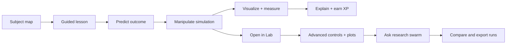

## 7. Technical stack

| Component | Recommended stack |
|---|---|
| Web/PWA | Next.js + TypeScript |
| UI | Tailwind + shadcn/ui + custom playful design system |
| 2D rendering | PixiJS or Canvas 2D |
| Optional 3D | Three.js / React Three Fiber |
| Charts | ECharts or uPlot |
| Offline simulation | Web Workers; Rust/WASM for numerical kernels when useful |
| Backend | NestJS |
| Scientific workers | Python + NumPy/SciPy; RDKit, Tellurium/libRoadRunner, COPASI, COBRApy, PhysiCell, BioSimulators adapters |
| Molecular visualization | Mol* / 3Dmol.js; Ketcher editor |
| Pathway editor | React Flow with typed reaction nodes |
| Scientific sources | Europe PMC; RCSB PDB |
| Queue | Redis + BullMQ |
| Persistence | PostgreSQL |
| Artifacts | S3-compatible object storage / MinIO |
| Realtime | SSE for agent updates, WebSockets for collaboration |
| Offline cache | Service Worker + IndexedDB |
| Hosting | Docker Compose on VPS behind Nginx/Caddy |

## 8. System architecture

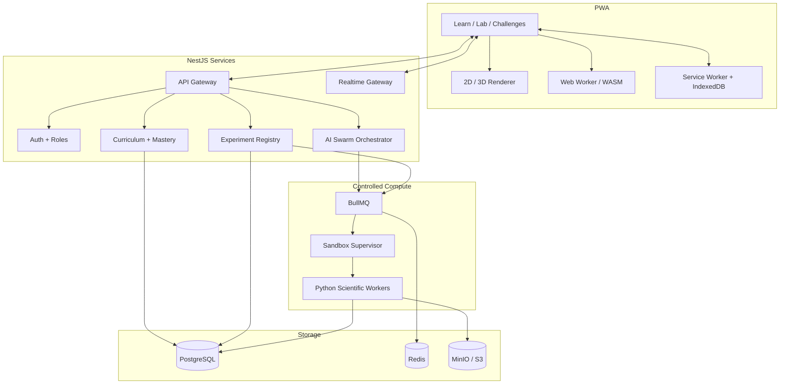

## 9. AI swarm design

| Agent | Job | Output |
|---|---|---|
| Orchestrator | Build task DAG | Auditable plan |
| Literature | Retrieve public sources | Citation manifest |
| Hypothesis | Form falsifiable questions | Structured hypotheses |
| Model selector | Select approved simulation | Model and rationale |
| Planner | Validate parameter sweeps | Run matrix |
| Executor | Schedule isolated jobs | Run logs and outputs |
| Analyst | Compare runs | Plots and statistics |
| Critic | Check units, assumptions and unsupported claims | Review |
| Narrator | Explain at learner level | Evidence-linked report |

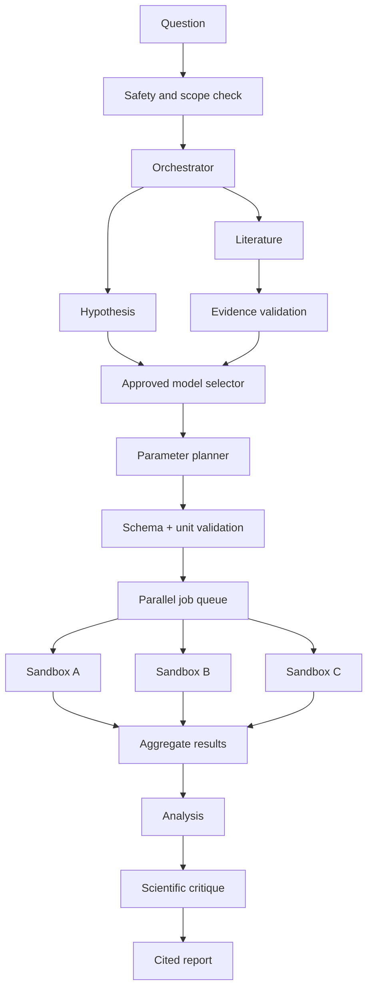

**Scientific core:** See Sections 20 onward for the fully integrated BioForge libraries, scientific adapters, orchestration, reproducibility, and lesson-to-lab mappings.

**Security:** allowlisted simulation images, no privileged containers, restricted egress, CPU/RAM/time quotas, read-only base images, per-run temporary storage, bounded outputs, cancellation and audit logs. Retrieved papers are untrusted data, never instructions. Models produce numbers; the LLM only interprets them.

## 10. Experiment-as-code contract

```yaml
id: cell-energy-001
version: 1.0.0
name: Save the Cell
domain: biology
runtime:
  engine: local-js
  entrypoint: cell-energy-v1
  deterministic: true
parameters:
  - {id: oxygen, type: number, unit: percent, min: 0, max: 100, default: 45}
  - {id: glucose, type: number, unit: percent, min: 0, max: 100, default: 35}
outputs:
  - {id: energy_index, unit: illustrative_percent}
  - {id: time_series, type: series}
learning:
  objective: Understand limiting resources
  completion_rule: energy_index >= 60
provenance:
  model_class: illustrative_educational
  limitations:
    - Not a validated cellular ATP prediction
```

Each run records ID, experiment/version, engine version, parameters and units, seed, status, timestamps, numerical outputs, artifact hashes, model limitations and references. Guided mode and Lab mode consume the same manifest and solver.

## 11. Offline and compute selection

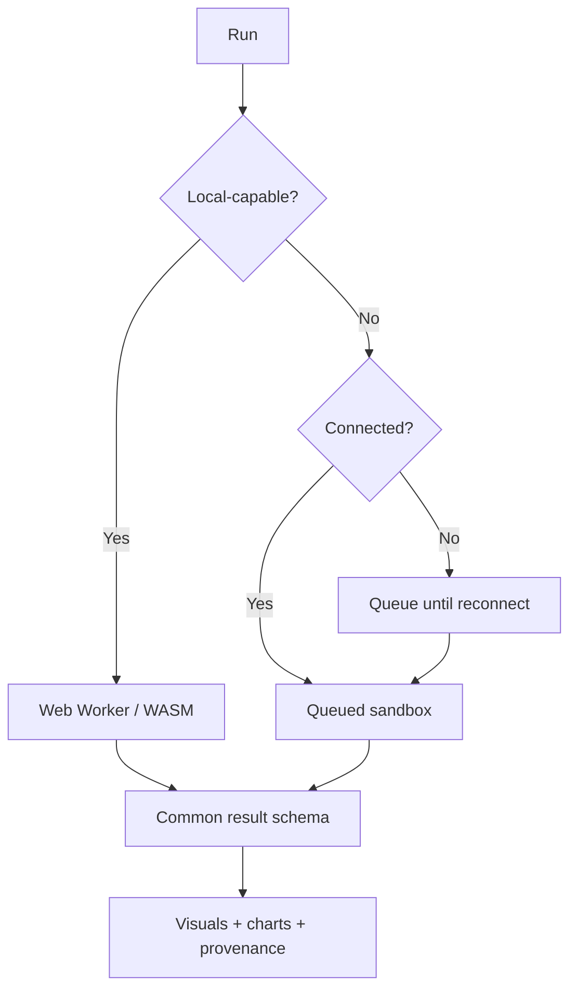

Offline progress events use unique IDs and idempotent reconciliation. Cloud-only AI and heavy jobs show a truthful offline state rather than simulated completion.

## 12. Database entities

`users`, `subjects`, `lessons`, `lesson_prerequisites`, `lesson_attempts`, `concept_mastery`, `experiment_definitions`, `experiment_runs`, `run_artifacts`, `investigations`, `agent_tasks`, `citations`, `challenges`, `challenge_attempts`, `classrooms`, `classroom_members`, `assignments`, `achievements`, `user_achievements`, `offline_events`.

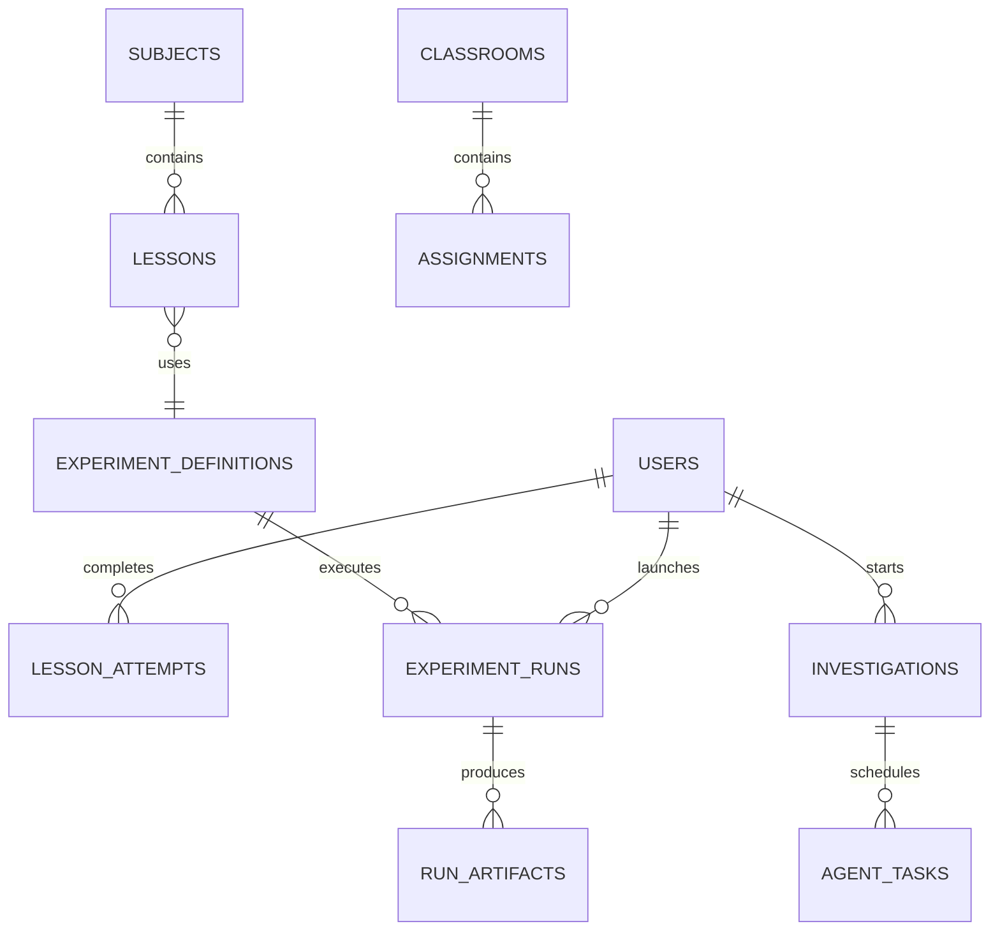

## 13. API surface

| Method | Endpoint | Action |
|---|---|---|
| GET | `/v1/subjects` | Browse worlds |
| GET | `/v1/lessons/:id` | Load lesson |
| POST | `/v1/lessons/:id/attempts` | Submit progress |
| GET | `/v1/experiments` | Browse catalog |
| GET | `/v1/experiments/:id/versions/:version` | Fetch manifest |
| POST | `/v1/runs` | Start simulation |
| GET | `/v1/runs/:id` | Retrieve outputs |
| GET | `/v1/runs/:id/artifacts` | List artifacts |
| POST | `/v1/investigations` | Start agent workflow |
| GET | `/v1/investigations/:id/events` | Stream SSE events |
| POST | `/v1/challenges/:id/attempts` | Submit challenge |
| POST | `/v1/sync/events` | Sync offline events |
| GET | `/v1/classrooms/:id/progress` | Teacher dashboard |

SSE events: `agent.started`, `agent.completed`, `run.queued`, `run.progress`, `run.completed`, `run.failed`, `investigation.completed`. Every event carries workflow ID, event ID, timestamp and typed payload.

## 14. UI direction

A playful but scientifically trustworthy visual language: rounded cards, bright mint/teal, yellow rewards, warm backgrounds, expressive original mascot, clear large controls and high-contrast text. The lesson map should feel game-like; the advanced laboratory should feel like a capable scientific workstation.

**Desktop Lab:** left experiment/scene tree, central simulation canvas, right parameters and model notes, bottom plots/timeline, top execution toolbar, collapsible AI panel.

**Mobile Lab:** central 2D visualization, bottom-sheet parameters, tabbed charts, simplified controls, accessible low-power rendering.

**Critical rule:** Every slider must change an actual model state. No fake plots, invented research citations or decorative pseudo-simulation.

## 15. VPS deployment

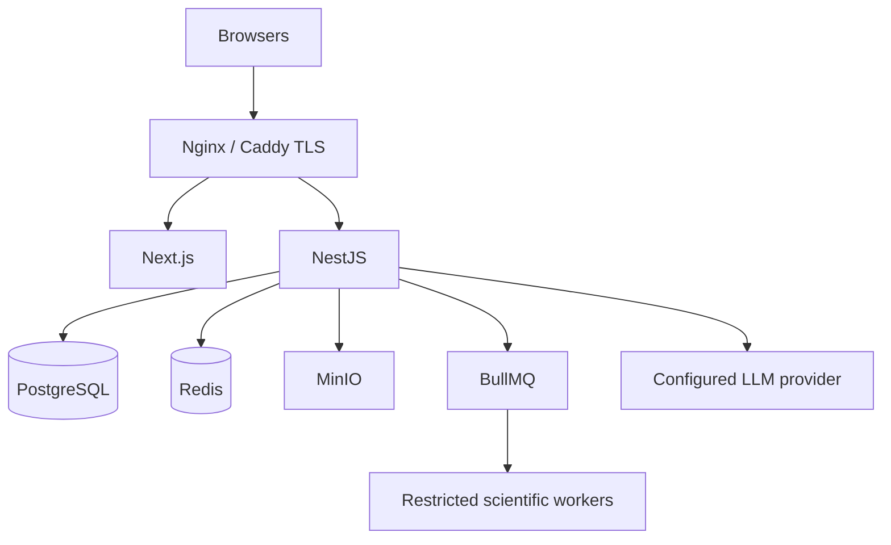

Docker Compose services: web, API, Postgres, Redis, MinIO, queue worker, sandbox supervisor, metrics/logging and reverse proxy. Use environment-based secrets, private internal networking, backups, per-user quotas, bounded concurrency and health checks.

## 16. Testing and acceptance

**Scientific:** unit checks, reference-case comparisons, numerical stability, deterministic replay, explicit assumptions and conservation tests where relevant.

**Product:** progression persistence, XP idempotency, accessibility checks, lesson-to-lab continuity, challenge scoring, teacher permissions.

**Infrastructure:** sandbox isolation, job cancellation, timeouts, retries, artifact integrity, rate limits, offline sync and low-memory rendering.

**AI:** tool schema validation, prompt-injection resistance, citation verification, clear distinction between sources and predictions, no unsupported numerical claims.

## 17. Hackathon pitch and demo

**Opening:** “We turned science from something you memorize into something you can actually touch.”

**Demo order:** show learning map → open Save the Cell → predict and manipulate → earn XP → open same experiment in Lab → ask AI to compare scenarios → display parallel runs and report → switch offline and run a cached experiment → show teacher-generated challenge.

**Technical proof points:** same versioned simulation across modes; real numerical model outputs; isolated parallel jobs; auditable agent traces; working offline local simulation; reproducible exports. Do not claim unmeasured performance, unbuilt features or scientific validation that has not been performed.

**Success criteria:** user can finish an interactive mission, launch an advanced lab run, compare two results, inspect provenance, complete a cached offline lesson and view an AI-generated report grounded in actual tool outputs.

## 18. Risks and mitigations

| Risk | Mitigation |
|---|---|
| Scientific inaccuracy | Vetted models, tests, provenance and limitations |
| AI hallucinations | Typed tool outputs, evidence links, critic review |
| Compute overload | Quotas, job queue, timeouts and local-first models |
| Low-end device performance | 2D fallback, reduced effects, local worker budgets |
| Offline inconsistencies | Idempotent event sync and conflict rules |
| Unsafe bio experimentation | Restricted educational models and scope validation |
| Copyright / naming | Original visual identity and commercial name check |
| Gamification overshadowing learning | Reward predictions, explanations and reproducibility |

## 19. Product positioning and long-term expansion

Senku is **an accessible scientific experimentation platform wrapped in a playful learning experience**, not a quiz app with science-themed graphics. Extend the experiment registry to additional subjects; allow teachers to publish validated lesson packs; enable community remixing; add collaborative labs; offer school subscriptions and hosted computational credits while retaining a useful free/offline experience.

**Final one-liner:** *Senku makes invisible science interactive, experimentation playful, research workflows automated, and scientific learning accessible anywhere.*

---

## 20. BioForge integration: the scientific core of Senku

The original BioForge concept is **not a separate product**. Its scientific toolchain becomes **Senku Scientific Core**. Learn Mode presents guided missions; Lab Mode exposes complete approved model parameters; Challenge Mode adds prediction and scoring; Discover Mode uses the AI swarm to coordinate reproducible simulations; Classroom Mode lets educators publish reviewed lessons. Every mode refers to the same experiment manifest, model version, solver and result format.

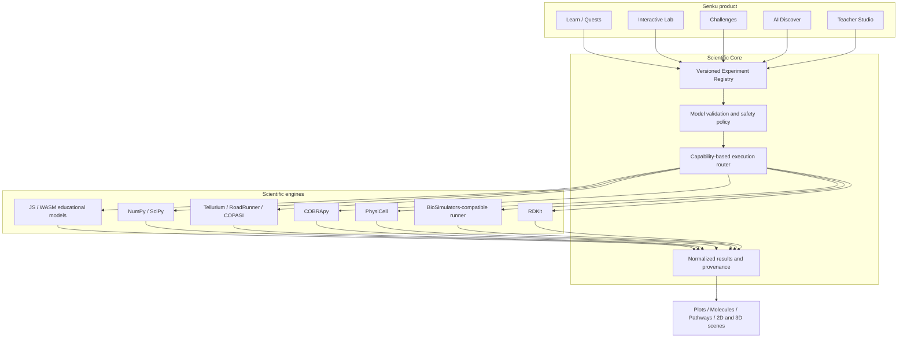

**Scientific honesty:** distinguish illustrative educational models, numerical predictions, literature-derived values, and measured data. A visualization is not proof that the underlying model is scientifically validated. Model assumptions, units, references and warnings remain visible in Lab Mode.

## 21. Full open-source scientific library registry

| Library / service | Role | Integration | Outputs | Limitations |
|---|---|---|---|---|
| **Mol*** | Interactive macromolecular structure visualization | Browser viewer loading vetted PDB/mmCIF | 3D protein structures, selections, annotations | Not a molecular dynamics engine |
| **3Dmol.js** | Lightweight molecular 3D viewer | Lazy-loaded browser component | Rotatable 3D structures | Choose one primary viewer per scene |
| **Ketcher** | Visual chemical structure editor | Embedded editor exporting supported molecule formats | SMILES/Molfile structures | Sanitize inputs; restrict hazardous chemistry workflows |
| **RDKit** | Cheminformatics parsing, 2D depictions and descriptors | Isolated Python worker | Validated molecules, depictions, basic descriptors | No claims of biological activity from descriptors |
| **Tellurium / libRoadRunner** | Curated biochemical kinetic simulations | SBML model adapter | Species trajectories, solver diagnostics | Model assumptions and units matter |
| **COPASI** | Reaction-network time courses and analysis | Dedicated controlled worker | Numerical trajectories and analysis artifacts | Check build-specific features and compatibility |
| **PhysiCell** | Safe multicellular/tissue-scale educational simulations | Dedicated restricted worker with approved scenarios | Cell-state frames, population summaries | Resource-intensive; no pathogen scenarios |
| **COBRApy** | Constraint-based metabolic modeling | Python worker using vetted metabolic models | Flux distributions, solver feasibility | FBA depends on objectives and constraints |
| **BioSimulators** | Standard-oriented execution across supported simulators | Compatible SED-ML/COMBINE execution adapter | Standardized model-run artifacts | Validate each simulator's actual compatibility |
| **NumPy / SciPy** | Numerical solvers and postprocessing | Scientific baseline worker | ODE solutions, heatmaps, statistics | Validate stability and numerical tolerances |
| **Europe PMC** | Scientific literature discovery | Read-only research retrieval connector | Citations, abstracts and evidence metadata | Retrieved text is untrusted data |
| **RCSB PDB** | Public structure discovery | Search and structure retrieval connector | PDB/mmCIF and provenance | Structure quality varies |
| **React Flow** | Visual biological pathway editor | Typed nodes for species, reactions and connections | Editable graphs compiled to vetted model schema | Drawn graph alone is not a valid biochemical model |

These are the planned scientific foundations, not a claim that every package has already been installed, validated or licensed for production. Pin versions, verify licenses, and test native-library compatibility before shipping.

## 22. Experiment-to-engine mapping

| Experience | Learn Mode | Lab Mode / actual engine | Outputs |
|---|---|---|---|
| Save the Cell | Balance resources in a game | Local educational model; optional curated COBRApy comparison | Resource index, state timeline, caveats |
| Enzyme Explorer | Predict rate saturation | SciPy kinetic model; RoadRunner or COPASI vetted SBML | Reaction-rate curves, time series |
| Pathway Playground | Connect species and reactions | React Flow → validated SBML → RoadRunner | Network graph, trajectories, SBML |
| Metabolism Explorer | Explore resource constraints | COBRApy on a curated toy metabolic network | Flux map, feasibility, solver status |
| Cell Colony | Observe multicellular patterns | PhysiCell with approved nonpathogenic preset | Cell frames, summary metrics |
| Molecule Museum | Explore protein structure | RCSB PDB → Mol* / 3Dmol.js | 3D structure, annotations, source metadata |
| Molecule Sketchbook | Sketch benign molecules | Ketcher → RDKit | Sanitized structure, depiction, descriptors |
| Diffusion Playground | Manipulate gradients | Browser JS/WASM or SciPy | Heatmap, conservation checks |
| Ecosystem Rescue | Restore a modeled pond | SciPy educational ODE system | Nutrient and oxygen trajectories |
| Genetics Lab | Predict inheritance ratios | Local seeded probability simulation | Ratios, sampling histogram |

All experiments expose parameter bounds, physical units where applicable, model status, deterministic seeds where supported, learning objectives, tests, and citations. The original pathogen-related sandbox concept is limited to **noninfectious toy models or precomputed public educational data**. No design, optimization or operational testing of harmful biological agents.

## 23. Integrated scientific workflows

### 23.1 From pathway editor to biochemical simulation

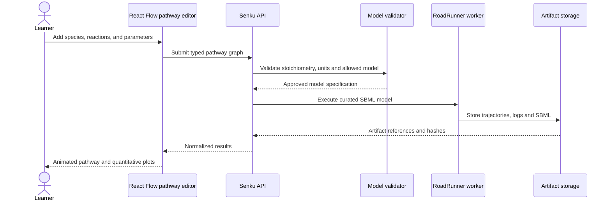

### 23.2 Structure exploration

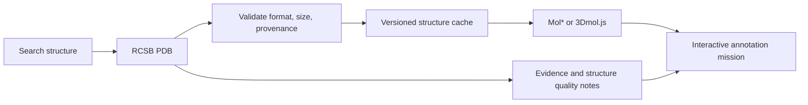

### 23.3 Parallel research swarm

A user asks how substrate concentration changes the behavior of a **preapproved enzyme model**. The Literature agent finds evidence through Europe PMC; Hypothesis agent frames a bounded question; Model Selector chooses a reviewed kinetic model; Planner creates a parameter sweep; Executor launches isolated jobs; Analyst compares outputs; Critic checks numerical warnings, units and claims; Narrator writes a source-linked explanation. The LLM never invents simulation outputs, executes arbitrary biological code or substitutes speculation for measurements.

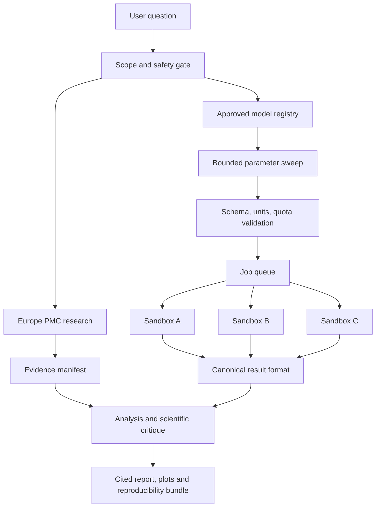

## 24. Scientific engine adapter contract

Each adapter implements `validate(input)`, `prepare(input)`, `execute(context)`, `normalize(output)` and `diagnostics(output)`. No user-uploaded code or arbitrary container images are accepted. The engine registry pins container digests, supported model formats, resource budgets, output types, network policy, and allowed experiment categories.

```yaml
id: enzyme-explorer-001
version: 1.2.0
subject: biology
modes: [learn, lab, challenge, discover]
model:
  id: enzyme-kinetics-educational
  scientific_status: illustrative_educational
  assumptions: [single-substrate, no-substrate-inhibition]
engine:
  id: scipy-ode
  adapter_version: 1.0.0
  image_digest: sha256:REPLACE_WITH_PINNED_DIGEST
  timeout_seconds: 30
  max_memory_mb: 512
  network: disabled
parameters:
  substrate_mM: {type: number, min: 0, max: 20, default: 2, unit: mM}
  vmax: {type: number, min: 0.01, max: 10, default: 1, unit: mmol_per_min}
  km_mM: {type: number, min: 0.01, max: 20, default: 2, unit: mM}
outputs:
  - {id: rate_curve, type: series, unit: mmol_per_min}
renderers: [line-chart, parameter-panel]
safety: {class: approved_educational, user_code: false}
provenance:
  reviewed_references: [] # Populate before publishing
  regression_suite: enzyme-kinetics-v1
```

Canonical run results contain `run_id`, `experiment_id`, `experiment_version`, `engine_id`, `engine_version`, `image_digest`, validated parameters with units, seed (if applicable), timestamps, status, scientific status, diagnostics, warnings, source references, and hashed artifacts. Artifact types include scalar, time series, matrix, spatial frame, molecule, network, document and table. The UI selects its renderer from the artifact's declared type, not from arbitrary LLM-generated UI code.

## 25. Sandbox isolation and scientific worker deployment

Run each native scientific stack in a **separate pinned worker image** rather than forcing RDKit, COPASI, RoadRunner and PhysiCell into one environment. The supervisor schedules by engine capability, workload weight and available memory. Use non-root execution, read-only base filesystem, ephemeral writable workspaces, dropped Linux capabilities, seccomp/AppArmor where available, bounded process count, CPU/memory/disk/time quotas, no host Docker socket inside workers, no privileged mode, and default-deny network egress. Dataset retrieval happens through separately permissioned connectors and cached vetted inputs.

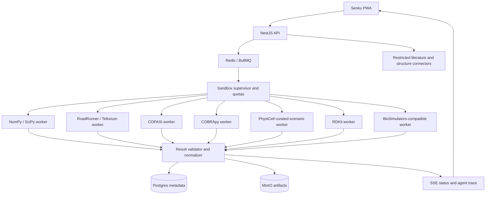

For a single VPS, enforce bounded heavy-job concurrency and queue the rest. Keep simple lessons running in Web Workers/WASM to preserve offline access. No claim of unlimited simulations or true offline execution of server-only scientific engines. WebGL viewers are optional, lazy-loaded, and have a 2D fallback.

## 26. Repo structure and module responsibilities

```text
senku/
  apps/
    web/                         # Next.js PWA, lessons, lab, teacher UI
    api/                         # NestJS auth, curricula, runs, investigations
  packages/
    experiment-schema/           # JSON Schema/Zod, units, manifests, outputs
    science-ui/                  # Mol*, 3Dmol, Ketcher, React Flow, charts
    learning-engine/             # quests, XP, mastery, assessments
    offline-runtime/             # Web Worker and WASM kernels
    agent-contracts/             # tool scopes, task DAGs, event schemas
  services/
    sandbox-supervisor/          # quotas, job lifecycle, image allowlist
    workers/
      numerics/
      roadrunner/
      copasi/
      cobrapy/
      physicell/
      rdkit/
      biosimulators/
    source-connectors/           # Europe PMC and RCSB PDB read-only clients
  content/
    experiments/                 # approved manifests and model assets
    lessons/                     # interactive missions and teacher packs
    challenges/                  # scoring rules and test fixtures
  infra/
    compose/                     # VPS services, private networks, reverse proxy
    monitoring/                  # traces, logs, health checks
  tests/
    scientific/                  # reference cases, stability, conservation
    integration/                 # adapter and lesson-to-lab contracts
    security/                    # resource limits, sandbox boundaries
```

## 27. Expanded database and API integration

Extend the earlier entities with `scientific_models`, `model_versions`, `engine_adapters`, `engine_capabilities`, `source_records`, `structure_assets`, `pathway_documents`, `simulation_batches`, `simulation_batch_members`, `run_diagnostics`, `artifact_manifests`, `model_validation_reviews`, and `experiment_publications`.

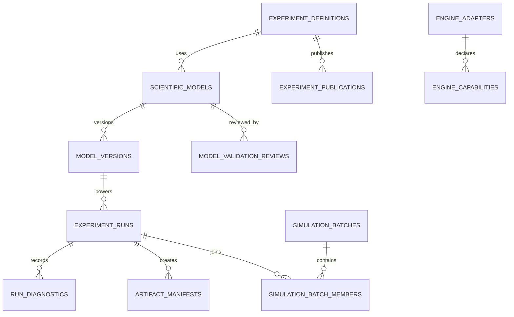

Additional endpoints: `GET /v1/engines`, `GET /v1/models`, `GET /v1/models/:id/versions`, `POST /v1/pathways/validate`, `POST /v1/pathways/compile`, `POST /v1/simulation-batches`, `GET /v1/simulation-batches/:id`, `POST /v1/structures/search`, `GET /v1/structures/:id`, `POST /v1/molecules/validate`, `POST /v1/molecules/describe`, `GET /v1/runs/:id/diagnostics`, and `GET /v1/runs/:id/reproducibility`. Apply auth, role policies, request limits, safe schema validation and scoped tool permissions.

## 28. End-to-end interface design: Duolingo meets real laboratory

**Home:** daily quests, streak, XP, lab shortcut, mascot companion, recommended scientific discoveries. **World Map:** subject → chapter → mission → checkpoint; each substantive lesson includes prediction, manipulation, observation and reflection. **Interactive Lesson:** full-screen scene with 1–3 meaningful controls, an explicit prediction prompt, quantitative feedback and a learn-why explanation. **Lab:** left experiment/model browser; central interactive 2D/3D viewer; right parameter panel and scientific assumptions; bottom plots and time controls; collapsible agent workspace. **Discover:** question input, source cards, agent DAG status, live job queue, side-by-side outputs and reproducibility export. **Teacher Studio:** lesson composer built on approved manifests, rubric editing, class assignment and misconception analytics.

**Render routing:** `structure` → Mol*/3Dmol.js; `chemical_graph` → Ketcher + RDKit outputs; `reaction_network` → React Flow; `time_series` → ECharts/uPlot; `spatial_cells` → Canvas/WebGL; `heatmap` → Canvas; `table` → accessible table. Low-end devices receive lighter assets and can disable 3D without changing the scientific run result.

## 29. Testing, scientific integrity and acceptance criteria

- **Model correctness:** reference-case outputs, unit consistency, solver convergence checks, known limiting cases, deterministic replay when supported, and explicit numerical tolerances.
- **Adapter compatibility:** pin image digests, test each approved input/output format, check error translation and diagnostics, verify artifact hashes and cancellation behavior.
- **Learning continuity:** a learner can complete Enzyme Explorer, open the same model version in Lab, run a bounded parameter sweep and return to the mission without losing progress.
- **Evidence:** every literature claim links to a real retrievable source; every structure identifies its PDB record; every quantitative plot links to the run that generated it.
- **Safety:** unsafe or unreviewed biological tasks are rejected; retrieved papers cannot override tool policies; no arbitrary code execution, untrusted worker images or unrestricted egress.
- **Accessibility:** keyboard-only lessons, textual plot descriptions, reduced motion, color-independent status, readable low-end mobile rendering, offline cached lessons.
- **Honest demos:** never substitute static images for real numerical results without labeling them as mockups. If an engine is unavailable, display an explicit unavailable state or use a clearly labeled educational model.

## 30. Complete hackathon demonstration narrative

1. Open **Senku** on a phone-sized viewport. Show the playful science world map and launch **Enzyme Explorer**.
2. Predict how substrate concentration affects reaction rate, move a slider, watch a **real calculated curve**, and earn XP for the scientific reasoning.
3. Select **Open in Lab**. Preserve the same experiment and model version, reveal its equations, units, references, and diagnostics.
4. Open **Pathway Playground**. Edit a safe, curated reaction network in React Flow and run the validated model using RoadRunner; inspect its trajectories.
5. Ask the **AI swarm** to compare several allowed parameter settings. Show the task DAG, sandbox job status, quantitative comparison and cited interpretation.
6. Switch to **Molecule Museum**. Retrieve a public protein structure from RCSB PDB and inspect it in Mol*; show source metadata and annotations.
7. Disconnect networking and complete a cached **Diffusion Playground** lesson using a local worker, proving the Works Anyway track.
8. Open Teacher Studio, choose a reviewed experiment template, generate a classroom challenge, and show the resulting learner progress view.

**Four-track mapping:** *Make the Invisible Visible* = structure and simulation visualization; *Make Room for Play* = quests, experimentation and challenges; *Works Anyway* = offline-first low-cost local science; *Kill the Busywork* = vetted AI-assisted research, lesson creation and parallel analysis. The product is integrated, not four disconnected demos.

**Definition of complete:** All visible controls invoke working scientific or educational models; core engines are accessible through typed adapters; agent tasks have real logs and results; reports cite actual sources; numerical claims are traceable; offline modes work as described; safe sandbox policies are enforced. Any unavailable optional native engine must be disclosed rather than simulated deceptively.

## 31. Positioning and non-negotiables

**Senku = playful science education on top of an extensible, reproducible computational-science laboratory.** The durable moat is not a streak system; it is a catalog of reviewed experiments, unified learning/lab runtime, accessible visualization, scientific interoperability and trustworthy AI orchestration. Biology is the first domain; the schema is designed to extend to chemistry, physics, environmental science and electronics without rewriting the user experience.

**Brand note:** Senku is associated with a fictional character from *Dr. Stone*. Use original artwork, personality and marketing assets, and review naming/IP clearance before a commercial release.
