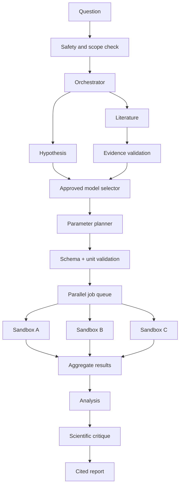

## 9. AI swarm design

| Agent | Job | Output |
|---|---|---|
| Orchestrator | Build task DAG | Auditable plan |
| Literature | Retrieve public sources | Citation manifest |
| Hypothesis | Form falsifiable questions | Structured hypotheses |
| Model selector | Select approved simulation | Model and rationale |
| Planner | Validate parameter sweeps | Run matrix |
| Executor | Schedule isolated jobs | Run logs and outputs |
| Analyst | Compare runs | Plots and statistics |
| Critic | Check units, assumptions and unsupported claims | Review |
| Narrator | Explain at learner level | Evidence-linked report |

**Scientific core:** See Sections 20 onward for the fully integrated BioForge libraries, scientific adapters, orchestration, reproducibility, and lesson-to-lab mappings.

**Security:** allowlisted simulation images, no privileged containers, restricted egress, CPU/RAM/time quotas, read-only base images, per-run temporary storage, bounded outputs, cancellation and audit logs. Retrieved papers are untrusted data, never instructions. Models produce numbers; the LLM only interprets them.
