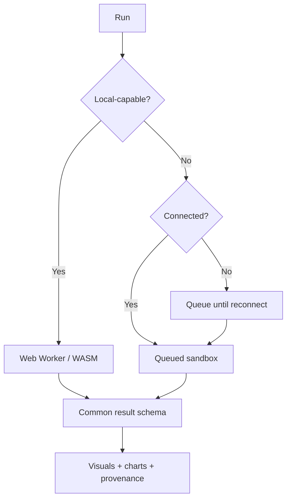

## 11. Offline and compute selection

Offline progress events use unique IDs and idempotent reconciliation. Cloud-only AI and heavy jobs show a truthful offline state rather than simulated completion.
