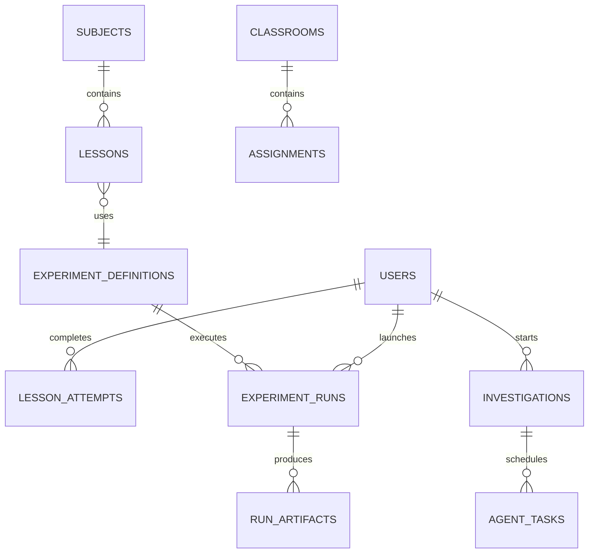

## 12. Database entities

`users`, `subjects`, `lessons`, `lesson_prerequisites`, `lesson_attempts`, `concept_mastery`, `experiment_definitions`, `experiment_runs`, `run_artifacts`, `investigations`, `agent_tasks`, `citations`, `challenges`, `challenge_attempts`, `classrooms`, `classroom_members`, `assignments`, `achievements`, `user_achievements`, `offline_events`.

