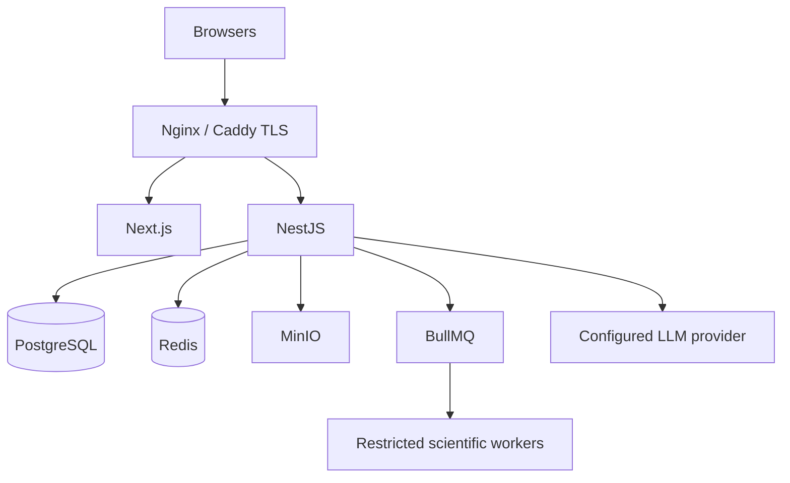

## 15. VPS deployment

Docker Compose services: web, API, Postgres, Redis, MinIO, queue worker, sandbox supervisor, metrics/logging and reverse proxy. Use environment-based secrets, private internal networking, backups, per-user quotas, bounded concurrency and health checks.
