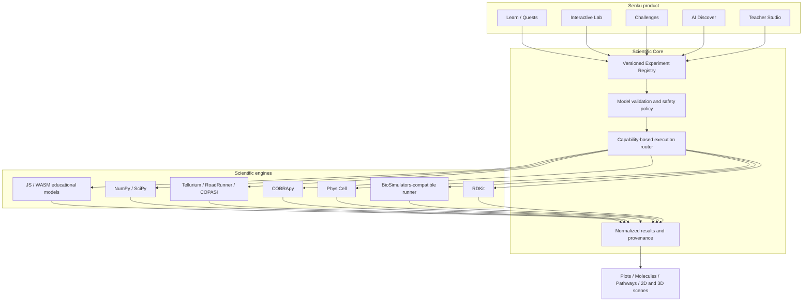

## 20. BioForge integration: the scientific core of Senku

The original BioForge concept is **not a separate product**. Its scientific toolchain becomes **Senku Scientific Core**. Learn Mode presents guided missions; Lab Mode exposes complete approved model parameters; Challenge Mode adds prediction and scoring; Discover Mode uses the AI swarm to coordinate reproducible simulations; Classroom Mode lets educators publish reviewed lessons. Every mode refers to the same experiment manifest, model version, solver and result format.

**Scientific honesty:** distinguish illustrative educational models, numerical predictions, literature-derived values, and measured data. A visualization is not proof that the underlying model is scientifically validated. Model assumptions, units, references and warnings remain visible in Lab Mode.
