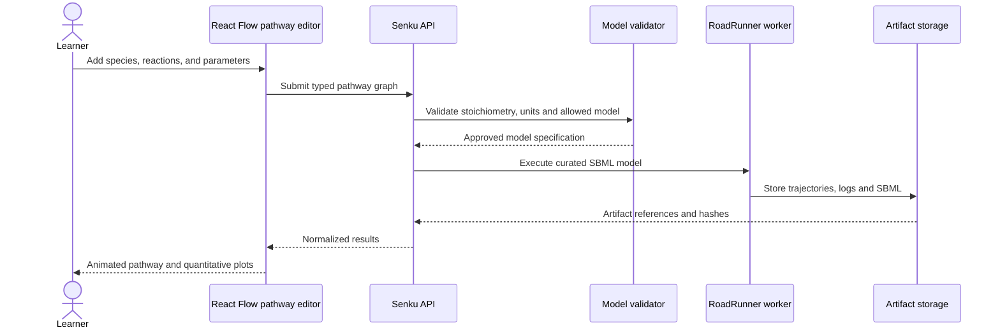
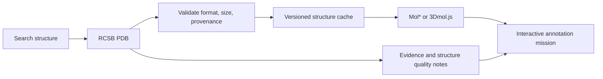
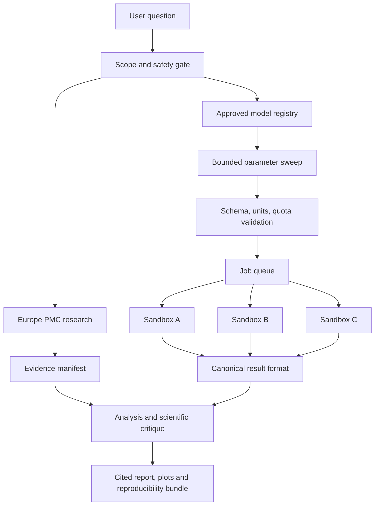

## 23. Integrated scientific workflows

### 23.1 From pathway editor to biochemical simulation

### 23.2 Structure exploration

### 23.3 Parallel research swarm

A user asks how substrate concentration changes the behavior of a **preapproved enzyme model**. The Literature agent finds evidence through Europe PMC; Hypothesis agent frames a bounded question; Model Selector chooses a reviewed kinetic model; Planner creates a parameter sweep; Executor launches isolated jobs; Analyst compares outputs; Critic checks numerical warnings, units and claims; Narrator writes a source-linked explanation. The LLM never invents simulation outputs, executes arbitrary biological code or substitutes speculation for measurements.

