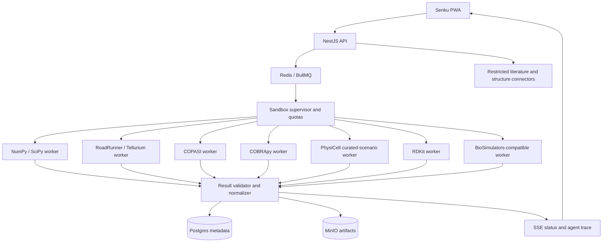

## 25. Sandbox isolation and scientific worker deployment

Run each native scientific stack in a **separate pinned worker image** rather than forcing RDKit, COPASI, RoadRunner and PhysiCell into one environment. The supervisor schedules by engine capability, workload weight and available memory. Use non-root execution, read-only base filesystem, ephemeral writable workspaces, dropped Linux capabilities, seccomp/AppArmor where available, bounded process count, CPU/memory/disk/time quotas, no host Docker socket inside workers, no privileged mode, and default-deny network egress. Dataset retrieval happens through separately permissioned connectors and cached vetted inputs.

For a single VPS, enforce bounded heavy-job concurrency and queue the rest. Keep simple lessons running in Web Workers/WASM to preserve offline access. No claim of unlimited simulations or true offline execution of server-only scientific engines. WebGL viewers are optional, lazy-loaded, and have a 2D fallback.
