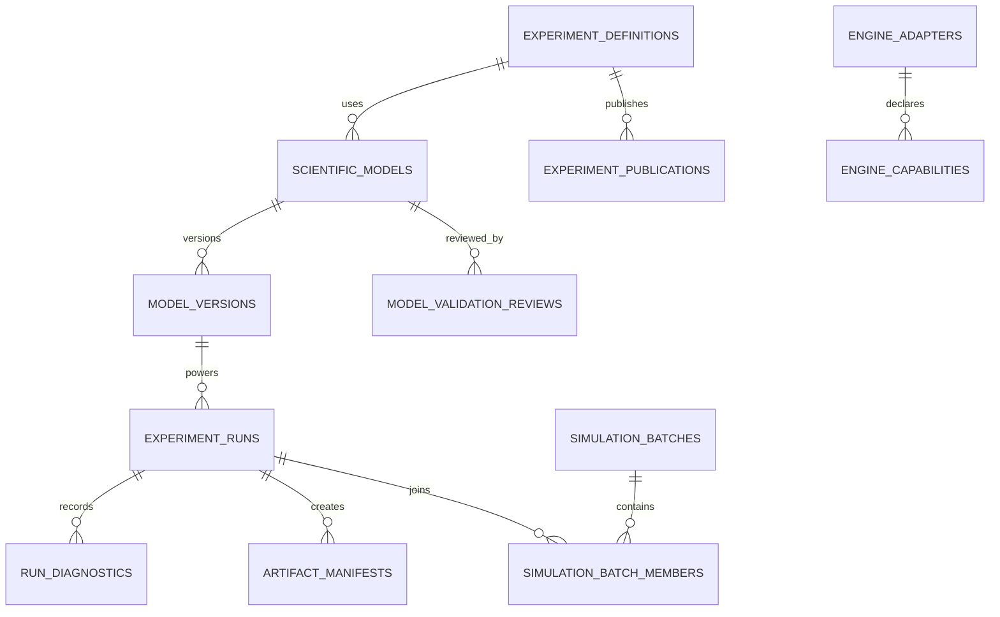

## 27. Expanded database and API integration

Extend the earlier entities with `scientific_models`, `model_versions`, `engine_adapters`, `engine_capabilities`, `source_records`, `structure_assets`, `pathway_documents`, `simulation_batches`, `simulation_batch_members`, `run_diagnostics`, `artifact_manifests`, `model_validation_reviews`, and `experiment_publications`.

Additional endpoints: `GET /v1/engines`, `GET /v1/models`, `GET /v1/models/:id/versions`, `POST /v1/pathways/validate`, `POST /v1/pathways/compile`, `POST /v1/simulation-batches`, `GET /v1/simulation-batches/:id`, `POST /v1/structures/search`, `GET /v1/structures/:id`, `POST /v1/molecules/validate`, `POST /v1/molecules/describe`, `GET /v1/runs/:id/diagnostics`, and `GET /v1/runs/:id/reproducibility`. Apply auth, role policies, request limits, safe schema validation and scoped tool permissions.
